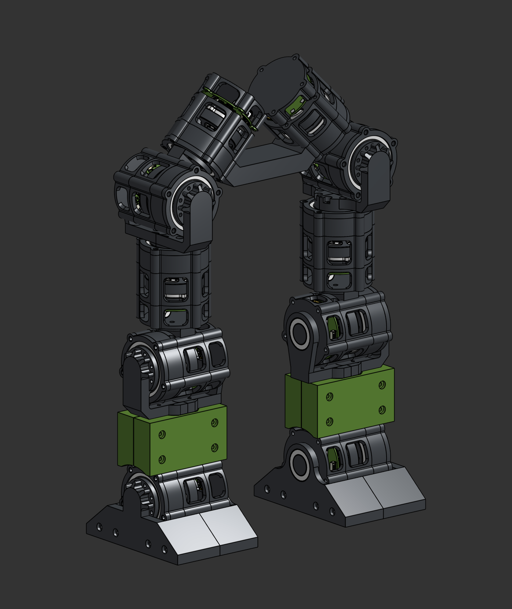
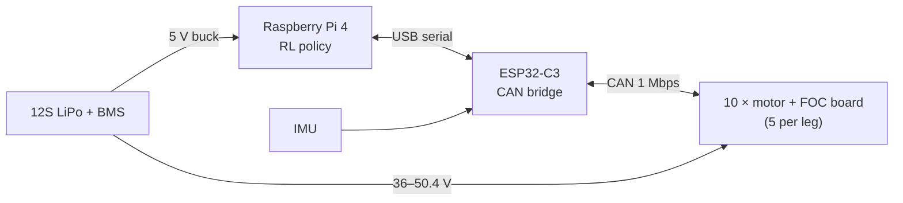

# ŻABKA

**Zero-moment Assisted Bipedal Kinetic Android**

ŻABKA ("little frog" in Polish) is a DIY 3D-printed bipedal robot with custom FOC motor controllers on every joint. The current focus is the legs.

## Specs (planned)

|                      |                                                                                                |
| -------------------- | ---------------------------------------------------------------------------------------------- |
| **Height**           | 0.45m (without upper body) 0.85m (full body)                                                   |
| **Legs**             | 5 DoF each (3 hip, 1 knee, 1 ankle), 10 DoF total                                              |
| **Actuators**        | MAD 5008 170KV BLDC motors, each with a custom STSPIN32G4 FOC controller board, on one CAN bus |
| **Compute**          | Raspberry Pi 4 running the walking policy, ESP32-C3 as the real-time CAN bridge                |
| **Power**            | 12S LiPo, two 6S 4000 mAh packs soldered in series (36–50.4 V)                                 |
| **Structure**        | 3D-printed PETG, 4 walls, 10–20 % infill                                                       |
| **Estimated weight** | ~8 kg without arms                                                                             |

## System overview

The Pi runs the walking policy at 50 Hz. The ESP32 exchanges commands and joint state with all 10 motor boards over CAN at 200 Hz, and each board closes its own FOC current loop and PD position loop. See [`docs/system_architecture.md`](docs/system_architecture.md) for the full design.

## Repository map

| Path                     | Contents                                                                  |
| ------------------------ | ------------------------------------------------------------------------- |
| [`BOM.csv`](BOM.csv)     | Combined bill of materials with running total                             |
| [`docs/`](docs/)         | System architecture, CAN protocol, per-category BOMs, datasheets          |
| [`cad/`](cad/)           | Onshape link and STEP exports of the printed parts                        |
| [`pcb/`](pcb/)           | KiCad project and JLCPCB fabrication files for the motor controller board |
| [`lib/`](lib/)           | Custom KiCad symbols, footprints and 3D models                            |
| [`firmware/`](firmware/) | Motor board FOC firmware and ESP32 CAN bridge firmware                    |
| [`software/`](software/) | Simulation, policy training and the code that runs on the Pi              |

## Status

| Subsystem                     | Status                                                                   |
| ----------------------------- | ------------------------------------------------------------------------ |
| Mechanical design             | Done ([Onshape](cad/))                                                   |
| 3D printing                   | In progress                                                              |
| Motor controller board        | Ordered from JLCPCB, shipping                                            |
| Motors, bearings, fasteners   | In hand                                                                  |
| Control and power electronics | Being purchased ([`electronics_BOM.csv`](docs/BOMs/electronics_BOM.csv)) |
| Firmware                      | Planned                                                                  |
| Walking policy                | Planned                                                                  |
