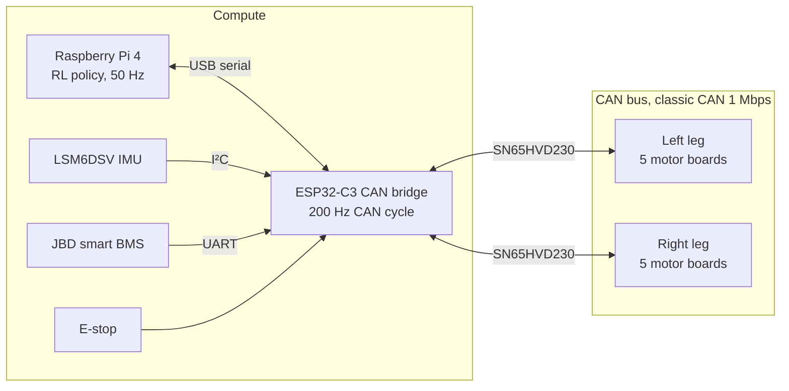

# System architecture

This document covers how ŻABKA's electronics fit together: the compute chain, the motor controller boards, power distribution and the safety system. The CAN bus itself (wiring, termination and message format) is covered in [`can_protocol.md`](can_protocol.md). Part numbers and prices are in [`BOMs/`](BOMs/).

## Overview



Each leg has 5 joints (3 hip, 1 knee, 1 ankle), for 10 joints in total. Every joint is a MAD 5008 170KV BLDC motor with a ŻABKA motor controller board mounted on its back.

The work is split into three layers so that only the lowest one has to be hard real-time:

| Layer | Runs on | Rate | Job |
| ----- | ------- | ---- | --- |
| Policy | Raspberry Pi 4 | 50 Hz | Reads the latest robot state and outputs joint targets. Not real-time. |
| Bridge | ESP32-C3 | 200 Hz | Fixed-rate CAN cycle, IMU, BMS polling, e-stop latch and Pi watchdog. |
| Joint | Motor board (STSPIN32G4) | 20–30 kHz | FOC current loop and a local PD (impedance) loop on each motor. |

## Compute chain

### Raspberry Pi 4

The Pi runs the walking policy (see [`software/`](../software/)). It reads the latest state packet from the ESP32 and writes new joint targets. It does not close any control loop itself, so Linux scheduling jitter does not affect joint control.

### ESP32-C3 CAN bridge

The ESP32-C3 has a built-in CAN controller (TWAI, classic CAN up to 1 Mbps) and connects to the bus through a Waveshare SN65HVD230 transceiver board. One USB cable to the Pi carries power, the serial link and reflashing.

Every 5 ms (200 Hz) the bridge:

1. sends one command frame to each of the 10 motor boards and collects their 10 replies;
2. reads the IMU (at 400 Hz or more), using the LSM6DSV's on-chip gravity vector or a Mahony filter on the ESP32;
3. checks the e-stop and the Pi watchdog;
4. streams one state packet to the Pi.

It also polls the BMS for cell voltages once per second.

**Why a bridge instead of CAN on the Pi?** An MCP2515 CAN HAT has only 2 receive buffers. The 10 replies arrive back-to-back about 120 µs apart, and Linux interrupt latency would overrun it. The ESP32 gives deterministic timing and can stop the motors on its own if the Pi crashes.

#### Serial link load

At 200 Hz the Pi-to-ESP32 link carries about 86 bytes down (10 commands plus a header) and 118 bytes up (10 motor states, gravity and gyro, battery status, header). That is 19 % and 26 % of a 921,600 baud link.

#### ESP32-C3 pin map (suggested)

| Function | ESP32-C3 pin | Goes to |
| -------- | ------------ | ------- |
| TWAI TX | GPIO 5 | SN65HVD230 `CTX` |
| TWAI RX | GPIO 4 | SN65HVD230 `CRX` |
| I²C SDA / SCL | GPIO 6 / GPIO 7 | LSM6DSV, 400 kHz to 1 MHz |
| E-stop | GPIO 3 | NC contact to GND with internal pull-up. Pressed **or a broken wire** reads high, so it fails safe. |
| BMS UART RX / TX (optional) | GPIO 1 / GPIO 0 | JBD UART port. Check its logic level first; if it is not 3.3 V, read the BMS over Bluetooth instead. |
| 3V3 / GND | 3V3 / GND | Transceiver and IMU power |
| USB | USB-C | Pi 4 USB port (power and serial) |

Avoid the C3's strapping pins (GPIO 2, 8, 9), the USB pins (GPIO 18, 19) and, on most modules, the flash pins (GPIO 12–17).

## Motor controller board

The motor controller is a custom 4-layer board, 58 mm round (72.97 × 69.84 mm overall due to the mounting tabs), that mounts on the back of each motor. The KiCad project and fabrication files are in [`pcb/`](../pcb/).

```text
12S battery (36–50.4 V)
   │
   J2 XT30 ── VM ──┬── C17 220 µF bulk cap + D3 TVS (VM to PGND)
                   ├── 3 half-bridges (Q101–Q302) ── phase pads TP101 / TP201 / TP301 ── motor
                   └── U1 STSPIN32G4 ── buck (L1, D2) ── gate drive and 3.3 V logic

U1 ── SPI ──── U5 AS5047P encoder (reads a diametric magnet on the motor shaft)
U1 ── CAN ──── U2 TCAN3414 ── J4 / J5 (CAN in and out, daisy-chained board to board)
U1 ── ADC ──── current shunts (R108 / R208 / R308), board temp (TH1), motor temp (J3), bus voltage (R11 / R12)
J1 ── SWD programming
```

| Block | Part |
| ----- | ---- |
| Controller and gate driver | STSPIN32G4 (STM32G431 + three-phase gate driver + buck in one package) |
| Power stage | 6 × HYG053N10NS1C2 100 V MOSFETs, three-shunt current sensing (1 mΩ) |
| Position sensing | AS5047P 14-bit magnetic encoder, 8 × 3 mm diametric magnet on the shaft |
| CAN | TCAN3414 transceiver, PESD1CAN ESD protection, two JST-GH connectors |
| Protection | 5.0SMDJ51A TVS on VM, 220 µF 100 V bulk capacitor |

### Connector pinouts

| Connector | Pin 1 | Pin 2 | Pin 3 | Pin 4 | Pin 5 |
| --------- | ----- | ----- | ----- | ----- | ----- |
| J2 power (XT30) | PGND (−) | VM (+) | | | |
| J4, J5 CAN (JST-GH 4-pin) | CANL | CANH | GND | spare | |
| J1 SWD (JST-GH 5-pin) | 3V3 | GND | SWDIO | SWCLK | NRST |
| J3 motor temp (GH 2-pin) | thermistor | GND | | | |

The board runs FOC and a local PD loop, MIT-style: each command carries a position, velocity, Kp, Kd and feed-forward torque. The board therefore only needs targets at the policy rate, and the bridge never closes the current loop. Firmware is in [`firmware/`](../firmware/).

## Power

The battery is a 12S LiPo made from two 6S 4000 mAh packs soldered in series (36–50.4 V).

```text
 Pack A (−) ──┬──────────────────────── BMS B−
              └──────────────────────── XT90-S (−) ── robot GND bus
 Pack A (+) ── series link ── Pack B (−)
 Pack B (+) ──┬── 30 A 58 V ATO fuse ── XT90-S (+) ─┬─ L leg trunk (14 AWG) ── 5 × XT30 taps (16 AWG)
              │                                     ├─ R leg trunk (14 AWG) ── 5 × XT30 taps (16 AWG)
              │                                     └─ 3 A 58 V ATO fuse ── DROK buck ── USB-C ── Pi 4 ── USB ── ESP32
              └──────────────────────── charge jack (+)
 BMS P− ────────────────────────────── charge jack (−)

 Balance: Pack A JST-XH B0..B6 → BMS B0..B6
          Pack B JST-XH B1..B6 → BMS B7..B12   (Pack B's balance black wire is left unconnected; it duplicates BMS B6)
```

- **The BMS is wired charge-only on purpose.** The robot's load bypasses the BMS's MOSFETs. A 20 A BMS would trip on walking current peaks and drop power mid-step, and opening the bus while the motors regenerate would pump the bus voltage toward the STSPIN32G4's 75 V limit. The BMS still stops charging when any cell reaches its limit, balances the cells and reports cell voltages.
- **Over-discharge is handled in firmware.** The ESP32 reads cell voltages at 1 Hz. Below 3.5 V per cell the robot sits down and alarms. Below 3.3 V the motors are disabled. Each motor board's bus-voltage sense is a second, pack-level check.
- **BMS settings:** in the xiaoxiang app, set the chemistry to Li-ion (4.2 V) with cell overvoltage at 4.20–4.25 V. LiFePO4 thresholds would stop charging at about 3.65 V per cell.
- **Fuses:** standard ATO/ATC fuses are rated 32 V DC and cannot safely break a 50.4 V arc, so both fuses are 58 V DC rated.
- **Inrush:** the XT90-S anti-spark connector handles the inrush into the 10 × 220 µF bulk capacitors.
- **Pi supply:** the DROK buck accepts 11–90 V, which leaves headroom above 50.4 V for regen spikes. Its output feeds the Pi's USB-C port so the Pi's own input protection stays in the path.
- **Charging:** use matched packs (same brand, capacity and age), and charge only with the robot idle.

## Safety and e-stop

1. Pressing the e-stop, a broken e-stop wire, or no packet from the Pi for 50 ms makes the ESP32 command every motor to damping (phase short). The legs slump instead of flopping, and no regen energy is pumped into the bus. The stop latches until it is reset.
2. Each motor board also goes to damping on its own if it receives no valid CAN command for 50 ms, which covers a dead ESP32.
3. The XT90-S is the hard power disconnect once the robot is stopped. A planned upgrade is a 48 V DC contactor in the main lead, driven by the e-stop's second NC contact.

## Upgrade paths

- **Second CAN bus:** the spare Raspberry Pi Pico can run [`can2040`](https://github.com/KevinOConnor/can2040) (CAN 2.0B at up to 1 Mbps on the RP2040's PIO). Splitting the bus, with the ESP32 on the left leg and the Pico on the right, doubles the bandwidth for a 500 Hz to 1 kHz loop at the cost of one more transceiver.
- **CAN FD:** any STM32G4 board could replace the ESP32 as a CAN FD bridge (1 Mbps arbitration, 5 Mbps data), using the TCAN3414's FD capability. That gives roughly 1.5 kHz on a single bus.

## Design history

An earlier design used a custom main board (STM32G474, BMI088 IMU, LM5146 buck, two CAN transceivers). It was dropped in favour of the off-the-shelf ESP32 bridge listed in [`BOMs/electronics_BOM.csv`](BOMs/electronics_BOM.csv), which needed no extra PCB and cost far less. If a custom main board is revived, the BMI088 should be replaced, since LCSC now marks it "not recommended for new designs".
